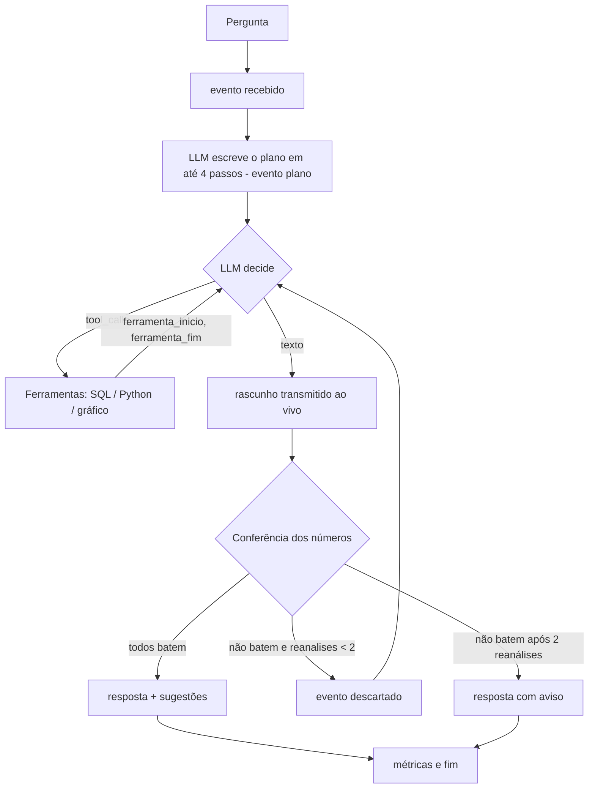
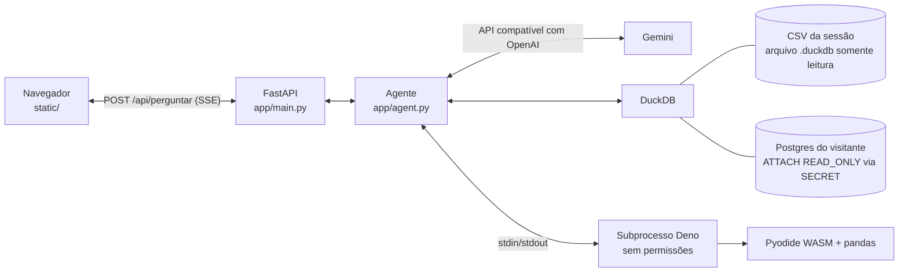

# Arquitetura

Última revisão: 2026-11-19. Tudo aqui foi conferido contra o código em `app/`, `sandbox/` e `static/`.

## Visão geral

Um processo FastAPI (1 worker) serve a página estática e uma API. O visitante carrega dados (CSV ou Postgres), faz uma pergunta e recebe a resposta em streaming SSE. O agente (`app/agent.py`) é um laço próprio, sem framework de agentes: chama o LLM com três ferramentas (`consultar_banco`, `rodar_python`, `gerar_grafico`), confere os números da resposta em código e refaz a análise até 2 vezes se algum número não bater.

## Fluxo do agente

Cada chamada ao LLM fecha com um evento `llm` (fase, modelo, ms, tokens). Qualquer limite estourado ou falha do provedor vira o evento `erro`, seguido de `metricas` e `fim`.

## Componentes

## Contrato de eventos SSE

`POST /api/perguntar` responde `text/event-stream`. Cada mensagem é `event: <nome>` + `data: <json>`. Os nomes e campos abaixo vêm de `app/agent.py` (`executar`). Eventos reproduzidos de uma gravação levam `"gravacao": true`.

| Evento | Campos | Quando |
|---|---|---|
| `recebido` | `modelo`, `turno` | Antes de qualquer chamada ao LLM |
| `plano` | `texto` | Fim da chamada do plano (o plano não é transmitido em pedaços) |
| `llm` | `n`, `fase` (`plano`, `ferramentas`, `resposta`), `modelo`, `ms`, `tokens_entrada`, `tokens_saida` | Fim de cada chamada ao LLM |
| `aguardando_cota` | `segundos` | O provedor devolveu 429 e o agente vai esperar para tentar de novo |
| `ferramenta_inicio` | `id`, `tipo` (`sql`, `python`, `grafico`), `sql`, `codigo` (só no Python) | Antes de rodar uma ferramenta |
| `ferramenta_fim` | `id`, `ms` e: `colunas`, `linhas`, `total_linhas` (SQL); `saida` (Python); `grafico` (gráfico); ou `erro` | Depois de cada ferramenta |
| `rascunho` | `delta`, `tentativa` | Texto da resposta em pedaços. O marcador `SUGESTOES:` nunca é transmitido |
| `conferencia` | `ok`, `falhas`, `tentativa` | Depois de cada rascunho completo |
| `descartado` | `tentativa`, `falhas` | O rascunho foi jogado fora e haverá reanálise |
| `resposta` | `texto`, `aviso`, `reanalises`, `sugestoes`, `conferido`, `turno` | Resposta final |
| `erro` | `mensagem` | Limite, cota, provedor indisponível, validação ou erro interno |
| `metricas` | `ms_total`, `chamadas_llm`, `chamadas_ferramenta`, `tokens_entrada`, `tokens_saida`, `reanalises`, `modelo`, `custo`, `trace_id`, `versao_prompt` | Sempre, antes do `fim` |
| `fim` | (vazio) | Último evento |

Ordem típica: `recebido`, `llm`, `plano`, (`llm`, `ferramenta_inicio`, `ferramenta_fim`)\*, `llm`, `rascunho`\*, `conferencia`, `resposta`, `metricas`, `fim`. Em `ferramenta_fim` com erro, o texto do erro volta ao LLM e o laço continua.

O contrato é executável: `static/fake-stream.html` carrega a tela inteira com `static/fake-api.js`, que troca `fetch` por um servidor falso que responde nesses eventos (perfil, métricas e feedback incluídos). Serve para desenvolver e testar a tela sem LLM nem backend.

## Outros endpoints

| Rota | Papel |
|---|---|
| `GET /` | `static/index.html` |
| `GET /api/status` | `restantes_hoje`, `teto_diario`, `modelo`, `gravacoes` (ids disponíveis) |
| `GET /api/metricas` | Agregado em memória: perguntas, respondidas, % conferidas, p50/p90, tokens médios, feedback, erros por tipo |
| `GET /api/exemplos` | Perguntas de exemplo (sem o gabarito) |
| `POST /api/sessao/csv`, `/exemplo`, `/postgres` | Criam a sessão e devolvem tabelas, perfil e perguntas sugeridas |
| `POST /api/conversa/nova` | Apaga a memória da sessão |
| `POST /api/feedback` | Nota `util`/`nao_util` do turno, com motivo opcional |

`/docs`, `/redoc` e `/openapi.json` estão desligados.

## Memória curta

`Sessao.historico` guarda os últimos 3 turnos (`MAX_TURNOS`). Cada turno tem pergunta, resposta, SQLs sem erro, um resumo de até 2.000 caracteres (`MAX_RESUMO`) e os resultados das ferramentas até 10.000 caracteres (`MAX_RESULTADOS`). O resumo entra no prompt de sistema; os resultados dos turnos anteriores entram na conferência, para que um número citado de novo ("e só em São Paulo?") continue verificável. Erros não entram no histórico. A memória vive só no servidor, por sessão, e "Nova conversa" a apaga.

## Perfil, grounding e dado pessoal

Ao criar a sessão, `app/perfil.py` calcula por coluna: nulos (%), valores distintos, mínimo e máximo (numéricas e datas) e até 5 exemplos. Colunas de texto com até 30 valores distintos (`LIMITE_VALORES`) entram inteiras no prompt como "grounding" (os valores possíveis), para o modelo filtrar por "Sul" e não por "sul". O perfil tem tempo limite de 10 s; se falhar, vira um perfil mínimo.

Dado pessoal: uma coluna é marcada `pii` (`cpf`, `email`, `telefone`) pelo nome ou quando 60% ou mais de uma amostra de 200 valores casa com o padrão. Colunas marcadas não têm exemplos nem valores no prompt, e o prompt de sistema manda só agregá-las. Isto reduz o vazamento para o LLM, mas não impede que o visitante escreva o dado na pergunta. No Postgres, o perfil usa amostra de 5.000 linhas e até 10 tabelas.

`perguntas_sugeridas` gera até 4 perguntas por regras sobre os tipos das colunas, sem LLM.

## Limites

| Limite | Valor | Onde |
|---|---|---|
| Ferramentas por pergunta | 8 | `agent.MAX_CHAMADAS` |
| Chamadas ao LLM por pergunta | 12 | `agent.MAX_CHAMADAS_LLM` |
| Reanálises | 2 | `agent.MAX_REANALISES` |
| Tempo por pergunta | 120 s (o restante é repassado ao LLM e às ferramentas) | `agent.LIMITE_SEGUNDOS` |
| Tempo por ferramenta | 30 s (ou o restante, se menor) | `agent._ferramenta`, `sql_tool.executar`, `python_tool.rodar` |
| Perguntas simultâneas | 1 (as demais recebem 429, ou a gravação se for um exemplo) | `main._VAGAS` |
| Teto diário global | 80, ou `DEMO_TETO_DIARIO` | `main.LIMITE_DIARIO` |
| Sessões | 200, TTL de 1 h | `main.MAX_SESSOES`, `sessions.TTL_SEGUNDOS` |
| Pergunta | 500 caracteres | `main.PerguntaIn` |
| Corpo JSON | 16 KB | `main.LIMITE_CORPO` |
| Upload de CSV | 20 MB (limite por Content-Length; corpo chunked recusado) | `sessions.MAX_CSV_BYTES` |
| Linhas devolvidas ao LLM | 1.000 por consulta, 50 no texto; 5.000 no gráfico | `sql_tool.executar`, `para_texto`, `agent.MAX_LINHAS_GRAFICO` |
| Linhas no `df` do Python | 100.000; acima disso a saída começa com um aviso de corte para o modelo agregar no SQL | `agent.MAX_LINHAS_PYTHON` |
| Texto de resultado | 10.000 caracteres | `sql_tool.MAX_CHARS` |
| Saída do Python | 10.000 caracteres; leitura do processo até 1 MB | `python_tool.MAX_CHARS`, `MAX_STDOUT_BYTES` |
| Sandboxes simultâneos | 2 | `python_tool.SEMAFORO` |
| DuckDB | `memory_limit` 512 MB, 2 threads, sem arquivos temporários | `sql_tool.LIMITES_DUCKDB` |
| Gráficos | ranking 12 barras (resto em "Outros"), composição 6 fatias, tendência 400 pontos e 4 séries, mapa de calor 31 x 24, dispersão 1.500 pontos | `app/graficos.py` |

Todos os contadores do teto diário e das sessões ficam em memória e reiniciam com o processo.

## Gravações e cassetes

- **Gravações** (`data/gravacoes/<id>.jsonl`): o stream de eventos de um caso da avaliação, gerado por `scripts/avaliar.py`. Quando o teto diário acaba, não há vaga, ou o provedor devolve 429 antes de qualquer evento substantivo, e a pergunta veio de um exemplo (`exemplo_id`), a API reproduz a gravação, com pausa de 40% do tempo original (no máximo 1,5 s entre eventos) e `"gravacao": true` em cada evento. A tela marca o turno com o selo "gravação". O `exemplo_id` só aceita ids que existem na pasta.
- **Cassetes** (`tests/cassetes/<id>.json`): as respostas do LLM de um acerto, gravadas com `--gravar-cassetes`. `tests/test_regressao.py` as reproduz pelo agente real, sem chamar o Gemini, e confere os números-chave. Sem cassete, o teste é pulado.

Ambos são gerados por uma execução real da avaliação; esta cópia do repositório ainda não os traz (`data/gravacoes/` não existe e `tests/cassetes/` só tem `.gitkeep`).

## Observabilidade

- **Trace**: cada pergunta tem um `trace_id` (12 hex) e a `versao_prompt` (`app/prompts.py`). O evento `metricas` entrega totais; os eventos `llm` e `ferramenta_fim` entregam o tempo de cada passo. A tela monta uma cascata com esses tempos, em um bloco recolhível.
- **Métricas**: `GET /api/metricas` agrega em memória (últimas 2.000 execuções): perguntas, respondidas, % conferidas, reanálises médias, p50 e p90, tokens médios, feedback por motivo e erros por tipo (`limite_tempo`, `limite_ferramentas`, `limite_llm`, `resposta_vazia`, `validacao`, `cota`, `provedor`, `interno`). Gravações reproduzidas não entram.
- **Log estruturado**: uma linha JSON por pergunta no logger `analista.metricas`, com `trace_id`, `ms`, contagens, tokens, `conferido`, `reanalises`, `erro_tipo`, `modelo`, `versao_prompt` e `gravacao`. Não tem pergunta, resposta nem dados. Erros inesperados registram só o tipo da exceção.
- **Custo**: o campo `custo` é o texto fixo "R$ 0 (plano gratuito)".

## Front-end

Sem build: HTML, CSS e módulos ES em `static/`. Apache ECharts 5.5.0 vem de CDN com SRI (`integrity` sha384) e a CSP só libera `script-src 'self'` e a CDN.

- **Trilho de passos e linha do tempo ao vivo** por turno (`turno.js`): plano, cada ferramenta (SQL, Python, gráfico) com código e tabela de resultado (até 100 linhas visíveis) e o rascunho aparecendo.
- **Conferência visível**: o rascunho aprovado recebe o selo "números conferidos"; um rascunho descartado fica marcado "descartado" e a resposta mostra "reanalisou N×". Se sobrar número sem conferência, aparece o aviso.
- **Trace em cascata**: bloco recolhível com tempo e tokens de cada chamada ao LLM e de cada ferramenta, mais totais e `trace_id`.
- **Gráficos** (`graficos.js`): ECharts com tema tirado das variáveis CSS, tema claro e escuro, botão "ver tabela" (até 200 linhas) e resumo acessível. Os 5 tipos: ranking, tendência, composição, mapa de calor (com `visualMap`) e dispersão com linha de tendência.
- **Painel de métricas da demo**: bloco recolhível que lê `/api/metricas`.
- **Feedback** 👍/👎 por turno, com motivo ao marcar 👎, enviado a `/api/feedback`.
- Cliente SSE próprio (`stream.js`) sobre `fetch` + `ReadableStream`, porque `EventSource` não faz POST. Todo texto do servidor entra por `textContent`.

## Módulos

| Arquivo | Papel |
|---|---|
| `app/main.py` | `create_app()`, rotas, SSE, teto diário, vaga única, gravações, métricas, log estruturado, cabeçalhos de segurança, limites de corpo |
| `app/agent.py` | Laço do agente, contrato de eventos, retentor do marcador `SUGESTOES:`, memória, cliente LLM com 429 e modelo reserva |
| `app/checker.py` | Conferência determinística dos números (formato BR, 1% de tolerância, `%`, "mil", "milhão") |
| `app/sql_tool.py` | Validação do SQL (extract_statements + árvore sintática), conexão travada, timeout, redação de segredos |
| `app/python_tool.py` | Subprocesso Deno, entrada por stdin, nonce, teto de 1 MB, semáforo |
| `app/graficos.py` | Moldagem dos 5 tipos de gráfico a partir do resultado SQL |
| `app/perfil.py` | Perfil dos dados, grounding, detecção de PII, perguntas sugeridas |
| `app/sessions.py` | Sessões isoladas (CSV vira um `.duckdb` próprio; URL Postgres só em memória), TTL |
| `app/prompts.py` | Prompts versionados (`VERSAO`) |
| `app/config.py`, `app/errors.py` | Variáveis de ambiente; `ErroUsuario` (mensagem segura em português) |
| `sandbox/runner.ts` | Executor Pyodide 0.28.3 + pandas dentro do Deno |
| `static/` | `index.html`, `app.js`, `turno.js`, `graficos.js`, `stream.js`, `dom.js`, `style.css`, `fake-api.js`, `fake-stream.html` |
| `scripts/gerar_exemplo.py` | Gera `data/pedidos.csv` e `data/perguntas.json` |
| `scripts/avaliar.py` | Avaliação com o LLM real; grava relatório, gravações e cassetes |
| `tests/` | Testes com LLM falso; regressão por cassetes |

Decisões e alternativas: [decisoes.md](decisoes.md). Ameaças e revisões de segurança: [seguranca.md](seguranca.md).
